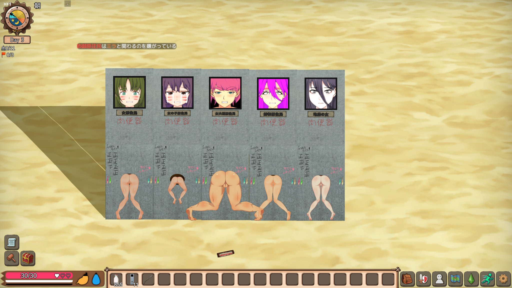
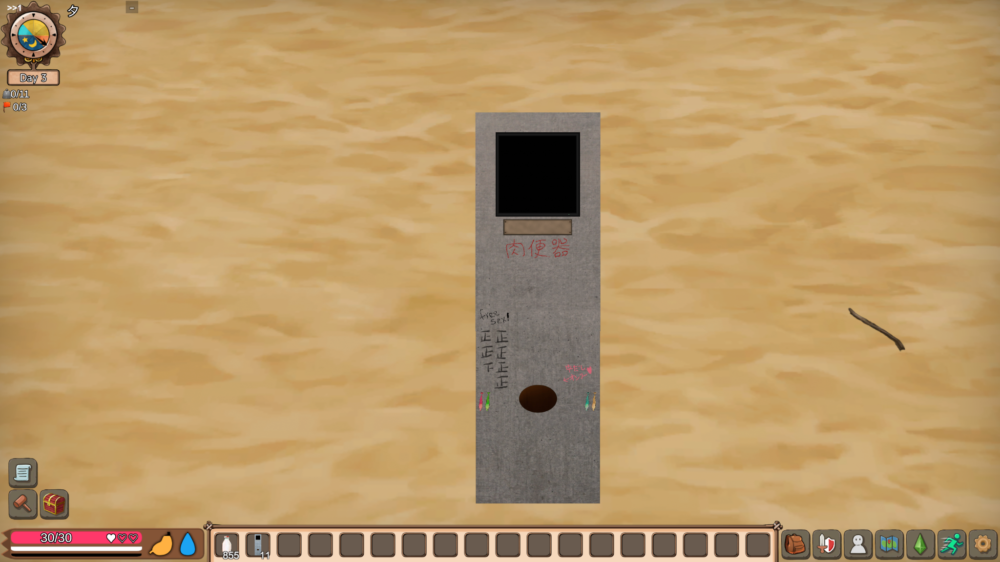
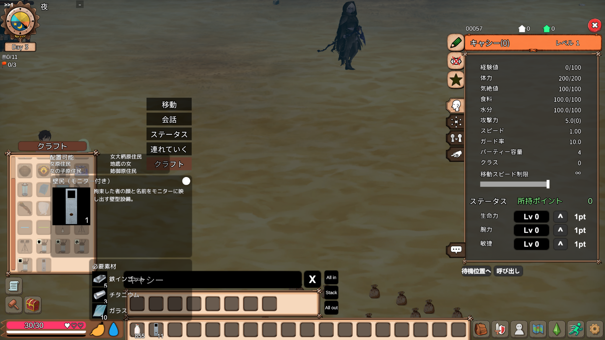

# WallHoleFaceDisplay v0.2.77

<!-- WHFD-SCREENSHOTS-BEGIN -->
## Screenshots / スクリーンショット

**Five monitors in use / 5台のモニター使用例**



| Empty facility / 未使用時の外観 | Crafting menu / クラフト画面 |
|:---:|:---:|
|  |  |

<!-- WHFD-SCREENSHOTS-END -->

## 日本語

### 概要
「壁尻（モニター付き）」を追加するMad Island用MODです。NPCの個体外見と名前をモニターに表示し、施設の通常・高速・フィニッシュ等の操作に追従します。対応NPC数値IDは15・16・17・44・90です。モニターは施設に固定され、NPC未セット時は黒画面になります。元の壁尻gen_asswall_00はバニラのままです。

### 動作要件と確認状況
- Windows版Mad Island、Unity Mono、ゲームに適合したBepInEx 5系。
- BepInExに付属する0Harmonyと、ゲーム付属のUnity・Spine・TextMeshProを使用します。これらのDLLはこのZIPへ同梱しません。
- ビルド対象は.NET Framework 4.7.2互換。必要なMono APIを備えるランタイムが必要です。
- 開発基準はUnity 2021.3.45f2 / Mono、BepInEx 5.4.23.5。v0.2.76までの実機成功環境です。v0.2.77はReleaseビルドと限定した設定・静的チェックまでで、Unity実機確認は未実施です。
- 同じ必要APIを備えた他のBepInEx 5系も想定し、インストール場所・パッチバージョン・ゲームDLLの開発環境ハッシュで起動を拒否しません。ただし、別のBepInEx 5バージョンや別ゲーム更新での実動作は未検証です。
- BepInEx 6、IL2CPP、Linux/macOS/Wine/Proton、ゲームAPIやアセット構造が大きく違う版は対応保証外です。
- BepInEx公式資料: https://docs.bepinex.dev/

### 導入・更新
1. ゲームを終了し、セーブをバックアップしてください。
2. ゲームに適合するBepInEx 5を導入してください。
3. ZIPのBepInExフォルダーをゲームフォルダーへ展開します。配置先はBepInEx/plugins/WallHoleFaceDisplay/WallHoleFaceDisplay.dllです。
4. 更新時は旧WHFD DLLをこのDLLへ置き換えます。別名・別フォルダーに古いDLLを残して二重導入しないでください。既存設定JSONやセーブをコピー・初期化する必要はありません。
5. ゲームを起動してください。開発用PowerShellや配備stateは不要です。

### クラフトと通常操作
NPC ID113のクラフトメニューで製作します。
- ironingot_01 ×5
- titanium_01 ×3
- glass_01 ×10
- 製作結果: whfd_prototype_00「壁尻（モニター付き）」×1

アイテムを通常どおり設置し、対応NPCをセットして施設の既存操作UIを利用してください。モードと表情は施設状態に追従します。
- 左Ctrl＋左Alt＋F10: 近くのモニターを選択。
- 左Ctrl＋左Alt＋F11: 固定モニターの取り外しはできません。施設全体は通常どおり撤去できます。
- NPC未セット・未対応NPCではモニター本体を維持し、対応映像を無理に再生しません。

旧試作whfd_asswall_00は新規クラフト・設置対象から除外されています。過去セーブのID解決は維持し、自動削除・変換はしません。

### 標準設定・個人設定
5種類のNPCの全4モードについて、調整済み画角・姿勢・表情・再生対応をDLLへ内蔵しています。個人設定JSONや診断ファイルがなくても利用できます。
既存のユーザー設定を優先します。既存モード設定の省略・クリアは共通値継承として維持します。不正な数値は可能な範囲で該当項目を内蔵値へ戻し、読めない・非対応形式のファイルはファイル単位で内蔵値へ戻します。元ファイルは書き換えず、診断警告を記録します。壊れたファイルに対する設定保存は無効になります。
設定フォルダーへ書けなくても、読み込みと内蔵設定で動作できる部分は継続します。初回のcfg生成は可能な場合だけ行い、既存cfgを起動時に上書きしません。保存操作を行う場合は書き込み権限が必要です。BepInEx自体が起動できない環境まで修復するものではありません。

### デバッグ機能
通常は無効です。必要な場合だけ、ゲーム終了後にBepInEx/config/local.madisland.wallholefacedisplay.cfgへ次を設定し、再起動してください。
```ini
[MonitorDebug]
EnableDebugUI = true
```
左Ctrl＋左Alt＋F6で既存の画角・姿勢・表情・アニメーション設定UI、左Ctrl＋左Alt＋F9で描画比較を使用できます。任意UIや診断出力の失敗は、通常設定・施設登録から切り離します。初期値はfalseです。

### ログ・既知の制限
問題時は、利用中のBepInExが出力するLogOutput.log等のログでWallHoleFaceDisplay、MonitorSettings、WHFD_Prototypeを確認してください。BepInExの設定によりファイル名・出力先が異なる場合があります。BepInExの起動エラー、ゲーム/ランタイム/BepInExのバージョン、数値NPC ID、発生操作を添えて報告してください。
必須API・描画アセットがない場合や、安全にパッチできないネイティブ構造の場合は、該当機能を停止して原因を記録します。ID衝突・実際のデータ不整合の確認は維持します。異なるゲーム更新や、同じ施設・UIを変更する他MODとの組合せは未検証です。利用可能な日本語フォントによって名前の書体が変わることがあります。
この候補では別環境のUnity実機での起動・描画・保存ロード・複数台動作を保証していません。

### 削除
ゲーム終了後にMODのDLLを削除します。ただし、正式施設・旧試作の設置物や所持品が残るセーブは、DLLなしで安全にロードできるとは限りません。削除前にセーブをバックアップし、対象セーブでMOD施設・所持品を通常操作で整理するか、互換DLLを残してください。セーブXMLの手動編集やID変換は行わないでください。設定ファイルの削除は必須ではありません。

---

## English

### Overview and requirements
Adds the placeable facility 壁尻（モニター付き） (wall restraint with monitor) to Mad Island. It displays the assigned NPC's appearance/name and follows the facility's existing playback controls. Supported numeric NPC IDs: 15, 16, 17, 44, 90. The monitor is fixed to the facility and shows black when empty. The vanilla gen_asswall_00 is unchanged.

Requires Windows Mad Island using Unity Mono and a suitable BepInEx 5 installation, including its 0Harmony. Uses the game's Unity, Spine and TextMeshPro assemblies; these are not redistributed. Targets the .NET Framework 4.7.2-compatible API surface.
The development baseline is Unity 2021.3.45f2 / Mono with BepInEx 5.4.23.5; v0.2.76 was tested in-game there. v0.2.77 has build and limited configuration/static checks only, with no Unity in-game verification yet. Other BepInEx 5 builds providing the required APIs are intended, but are not confirmed. There is no exact installation-path, patch-version or developer game-DLL hash gate. BepInEx 6, IL2CPP, other operating systems/runtimes and significantly changed game APIs/assets are not guaranteed.
Official BepInEx documentation: https://docs.bepinex.dev/

### Install / update
Close the game and back up saves. Install the correct BepInEx 5 build, then extract this ZIP's BepInEx directory into the game directory. The DLL belongs at BepInEx/plugins/WallHoleFaceDisplay/WallHoleFaceDisplay.dll.
For updates, replace the previous WHFD DLL and avoid duplicate copies in other plugin folders. Keep existing user settings and saves. Developer scripts, deployment state, personal JSON files and diagnostics are not required.

### Crafting / use
Craft with NPC ID113: ironingot_01 ×5, titanium_01 ×3, glass_01 ×10, producing whfd_prototype_00 ×1. Place it normally, assign a supported NPC and use the existing facility controls.
Left Ctrl + Left Alt + F10 selects a nearby monitor. F11 with the same modifiers cannot remove a fixed monitor; the entire facility can still be removed normally. Empty/unsupported assignments do not force NPC video playback.
The retired whfd_asswall_00 is no longer newly craftable/placeable. Existing saved references remain resolvable and are not deleted or converted.

### Defaults / debug settings
All four modes for the five NPC IDs have embedded framing/pose/expression/playback defaults. No personal JSON or generated diagnostic files are needed. Existing user settings take priority, with existing common-value inheritance preserved. Invalid fields use an appropriate bundled fallback when possible; unreadable/unsupported documents fall back as a whole. Original files remain untouched, warnings are logged and saving damaged files is disabled.
Read-only configuration storage does not prevent in-memory defaults from being used. Initial cfg creation is best-effort; an existing cfg is not rewritten at startup. Explicit saving still requires write permission. The mod cannot repair a BepInEx installation that itself cannot load.
To enable developer tools, edit BepInEx/config/local.madisland.wallholefacedisplay.cfg while the game is closed and restart:
```ini
[MonitorDebug]
EnableDebugUI = true
```
Default is false. Left Ctrl + Left Alt + F6 opens the existing editor; F9 with the same modifiers performs rendering comparison. Optional UI/diagnostic failures are isolated from normal configuration and registration.

### Troubleshooting / limitations / uninstall
Check BepInEx's configured log, commonly LogOutput.log, for WallHoleFaceDisplay, MonitorSettings and WHFD_Prototype. Log names/locations can vary. Include game/runtime/BepInEx versions, numeric NPC ID and reproduction steps when reporting problems.
Actual missing APIs/assets, unsafe native patch structures, ID collisions and data inconsistencies still stop the affected feature with diagnostics. Other game updates and mods modifying the same facilities/UI are unverified. Available Japanese fonts can change the name-label typeface. Alternate-environment startup, rendering, save/load and multi-monitor behavior need in-game verification.
To uninstall, close the game and remove this mod's DLL. First back up saves and remove its facilities/items through normal gameplay, or keep a compatible DLL for saves retaining either custom ID. Loading such saves without the mod may be unsafe. Do not edit save XML or convert IDs manually. Removing configuration files is optional.
